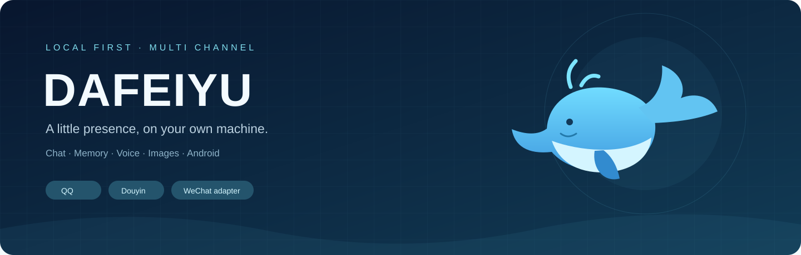

<div align="center">



# 大肥鱼 · Dafeiyu

**让聊天、记忆和本机工具，在同一个工作区里接上。**

[](https://github.com/vivofiftykfc/dafeiyuqq/actions/workflows/ci.yml)
[](LICENSE)
[](docs/DEPENDENCIES.md)
[](https://nodejs.org/)

[快速开始](docs/QUICKSTART.md) · [依赖清单](docs/DEPENDENCIES.md) · [脚本](docs/SCRIPTS.md) · [架构](docs/ARCHITECTURE.md) · [排障](docs/TROUBLESHOOTING.md) · [English](README.en.md)

</div>

## 这是什么

大肥鱼是一个面向 Windows 的本地 AI 陪伴工程。它把 QQ、抖音和可选的微信适配器接到 DeepSeek Harness，将会话记忆、日记、语音、生图与 Android 手机工具放在可检查的目录里。

仓库提供集成源码、配置入口和教程。模型权重、第三方客户端、登录状态和个人聊天数据需要在你自己的电脑上准备。回复模型通过你配置的服务调用；“本地优先”指数据组织和工具运行方式，不表示所有模型都离线。

## 能做什么

| 模块 | 能力 | 使用条件 |
|---|---|---|
| QQ | 接收、分条回复、表情、会话模式、空间工具 | QQ小号、SnowLuma、DSH |
| 抖音 | 私信协议连接、逐联系人开关、媒体上下文 | 自己的账号授权与协议会话 |
| 记忆 | 按平台/账号/会话隔离，摘要与原文归档 | 本地SQLite |
| 人格与日记 | 基础人格、事实账本、成长版本、私人日记 | 自己填写设定；默认空数据 |
| 语音 | Qwen3-TTS生成、任务查询和发送 | 独立Python环境、模型与获授权音色 |
| 生图 | ComfyUI队列、角色参考、生成结果回传 | ComfyUI、GGUF节点和模型 |
| 手机 | ADB截图、观察、点击、输入和公开内容浏览 | Android真机、USB授权 |
| 微信 | 原生接收与统一核心对接 | **进阶适配**；固定版本客户端、原生后端、账号绑定 |

## 从哪里开始

先完成QQ文字闭环，再按需添加其他模块：

```powershell
git clone https://github.com/vivofiftykfc/dafeiyuqq.git
cd dafeiyuqq
npm ci --prefix qq-bridge
npm ci --prefix tutorial-kit
npm run configure -- --owner-qq 你的主号 --bot-qq 机器人小号 --dsh-root "D:/APPs/dsh/DeepSeek Harness"
```

随后安装SnowLuma、配置HTTP令牌、准备DSH专用profile，按[快速开始](docs/QUICKSTART.md)逐步验证。以上命令不会替你登录账号，也不会自动启动全套服务。

## 目录

```text
dafeiyuqq/
├─ qq-bridge/          # 消息、控制台、MCP、统一记忆与策略
├─ tutorial-kit/       # 共享日记、手机与空间工具；不是纯教程附件
├─ wechat/integration/ # 可选微信集成源码；原生后端单独准备
├─ services/voice/     # Qwen3-TTS服务源码和环境锁
├─ tools/douyin-im/    # 抖音SDK源码、构建产物与依赖声明
├─ scripts/           # 配置、检查、启动和离线验证
├─ docs/              # 安装、依赖、架构、迁移与排障
└─ assets/            # 仓库展示素材
```

运行后产生的 `state`、`local`、`runtime`、日志和账号配置均不进入Git。具体数据位置见[架构说明](docs/ARCHITECTURE.md)。

## 运行和验证

```powershell
npm run doctor  # 检查本机前置条件与端口
npm run check   # JavaScript语法及JSON检查
npm test        # 隔离的离线测试，不发送真实消息
```

完整一键启动器面向已配置好全套依赖的本机部署；首次安装和只使用QQ时，请使用教程中的分项启动。控制台默认在 `http://127.0.0.1:3100`，仅供本机访问，使用本地生成的令牌。

## 当前边界

- 这是从实际使用工程整理的首个公开源码版本，仍在拆分历史配置。QQ路径提供安装步骤；微信目前是进阶集成源码，不是一键安装包。
- 自动化不绕过账号登录、手机锁屏或设备授权。发送超时要先核查结果，不能当作失败直接重发。
- 新安装只允许你填写的主人私聊，群聊为空，不自动开启自主发布或联系人自动回复。
- CI验证源码和离线逻辑；真实收发、模型推理、显存使用和原生客户端兼容性需要在目标电脑验收。

## 参与和致谢

欢迎提交可复现的问题、脱敏日志和小范围改进。请先读[贡献指南](CONTRIBUTING.md)与[安全说明](SECURITY.md)。

本工程基于 [qq-bridge](https://github.com/Derpyu520/qq-bridge)、[AI Companion Kit](https://github.com/pinganbbOvO/ai-companion-kit) 和 [douyin-im](https://github.com/zhinjs/douyin-im) 扩展，连接 [DeepSeek Harness](https://github.com/deepseek-ai/deepseek-harness)、[SnowLuma](https://github.com/SnowLuma/SnowLuma)、[ComfyUI](https://github.com/Comfy-Org/ComfyUI)、[Qwen3-TTS](https://github.com/QwenLM/Qwen3-TTS) 等项目。保留的许可与外部依赖见 [THIRD_PARTY_NOTICES.md](THIRD_PARTY_NOTICES.md)。
