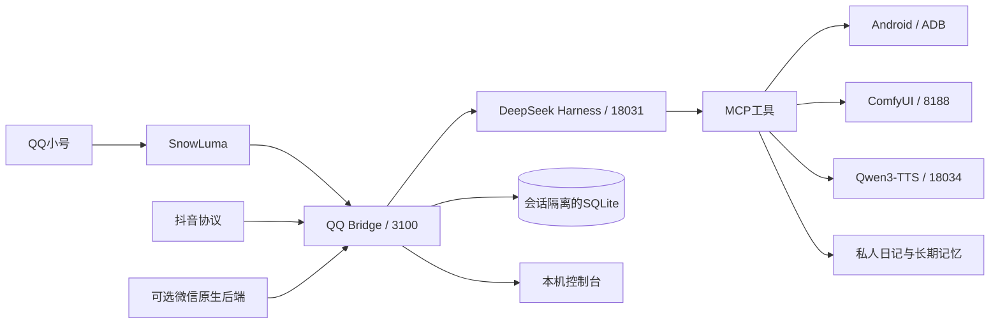

# 架构与数据位置

QQ/抖音/微信共用桥接与记忆能力，但会话键由平台、登录账号和对端组成。数据库归档保留原文与摘要，摘要不是原始消息的替代证据。

| 内容 | 相对仓库根目录 |
|---|---|
| 主连接配置 | `qq-bridge/config.json`（本地生成） |
| 模式和会话映射 | `qq-bridge/state/mode.json`、`sessions.json` |
| 统一聊天记忆 | `qq-bridge/state/chat-memory.sqlite` |
| 自主活动 | `qq-bridge/state/autonomy.sqlite` |
| 人格与事实 | `qq-bridge/state/owner/identity.md`、`memory.json` |
| 日记和观察记录 | `qq-bridge/state/owner/diary`、`observations.jsonl` |
| 日记额外副本 | `local/diary-desktop` |
| 手机留痕 | `qq-bridge/state/owner/phone-history`、`phone-shots` |
| 图片 | `assets/identity`、`assets/generated`、`assets/shared` |
| 微信本地运行环境 | `wechat/runtime` |
| 微信绑定配置 | `wechat/local` |
| QQ DSH profile | 用户目录 `.dsh/profiles/dafeiyuqq` |
| 微信 DSH_HOME | `wechat/runtime/dsh-home` |

人格插件、主人工具、消息桥接分别负责注入、执行和投递。第三方网页、通知、评论和群友消息只作为资料，不能替主人扩大本机权限。私人记忆和公开分享不应共用同一输出渠道。

SQLite运行期间可能有 `-wal/-shm` 伴随文件。迁移应先正常停止写入或使用SQLite备份接口，不只复制一个正在使用的 `.sqlite` 文件。完整迁移步骤见[迁移说明](MIGRATION.md)。
